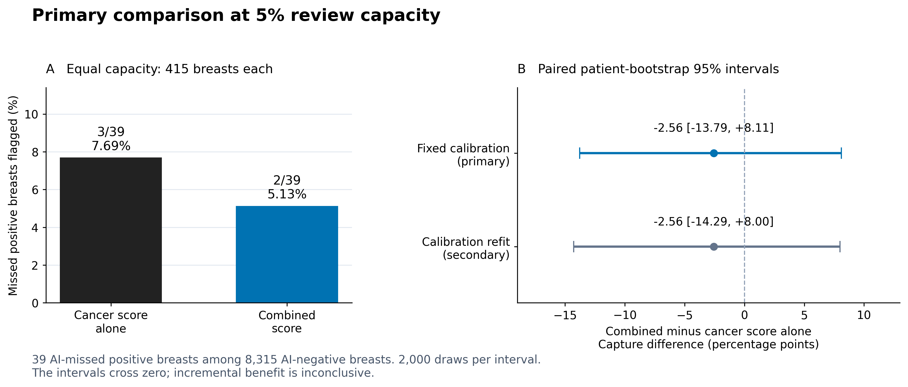

# Mammography reliability: fixed-GMIC review prioritization

Code and aggregate results for a completed retrospective RSNA mammography study. We evaluated whether CC–MLO disagreement and between-model variation improve the prioritization of cancer-positive breasts missed by a fixed, externally trained five-member GMIC ensemble.

**Primary result:** at equal 5% global review capacity, combined scoring flagged **2 of 39** AI-missed positive breasts, compared with **3 of 39** for cancer score alone. Each method selected **415 breasts**. The capture difference was **−2.56 percentage points**, with primary paired patient-bootstrap 95% interval **[−13.79, +8.11]**. Added benefit is inconclusive; this is not an equivalence result.



## Run the reproducible aggregate package

Use Python 3.12. No medical data or GPU is needed for these commands:

```bash
python -m venv .venv
source .venv/bin/activate
python -m pip install -r requirements-report.txt
python scripts/verify_release.py
python -m unittest discover -s tests -p 'test_fixed_gmic_*.py' -v
python scripts/make_release_figures.py --output reproduced_reports
```

These commands verify the unchanged scientific source, run 18 artificial-data checks, reconstruct both reported intervals from 4,000 saved bootstrap draws and regenerate the three figures and six table sections. They do not rerun patient-level inference. Exact commands, private input requirements and verification limits are in [REPRODUCIBILITY.md](REPRODUCIBILITY.md).

## Study at a glance

| Item | Completed study |
|---|---|
| Development | 2,383 patients; 4,766 breasts; 99 positive breasts |
| Holdout | 9,530 patients; 19,060 breasts; 393 positive breasts |
| Model | Five fixed released NYU GMIC members; no RSNA weight training |
| Evaluation | One patient-separated holdout, processed in five computation shards |
| Classification | TP 354, FN 39, TN 8,276, FP 10,391 |
| Sensitivity / specificity | 90.08% / 44.33% |
| ROC-AUC / average precision | 0.77245 / 0.12907 |
| Primary review pool | 8,315 AI-negative breasts |
| Prespecified comparison | Combined versus cancer score alone at 5% capacity |
| Secondary uncertainty | Calibration-refit interval [−14.29, +8.00] percentage points |

The combined score averages the development-reference percentiles of calibrated cancer score, absolute CC–MLO disagreement and between-member population variance. Selection is global, uses no holdout labels and preserves a deterministic tie rule. Full definitions remain in the unchanged [frozen protocol](FIXED_GMIC_FINAL_PROTOCOL.md) and [configuration](fixed_gmic_final_config.json).

## Results and source map

- [Full result report](FIXED_GMIC_FINAL_RESULTS.md), [tables](reports/TABLES.md) and [figure captions](reports/CAPTIONS.md).
- [Study flow](reports/figure_1_study_flow.pdf), [primary comparison](reports/figure_2_primary_comparison.pdf) and [all-method capture curves](reports/figure_3_capture_curves.pdf). SVG and 300-dpi PNG versions are included.
- `fixed_gmic_evaluation.py`: breast pooling, score construction, global ranking and paired patient bootstrap.
- `fixed_gmic_prepare.py`, `fixed_gmic_gate.py`, `gmic_final_inference.py`, `fixed_gmic_final_analysis.py`: original calibration, freeze, shard inference and verified global analysis.
- `gmic_adapter.py`, `gmic_fullfield.py`, `gmic_preflight.py`: inspected adaptation of separately obtained upstream GMIC code and weights.
- `validation/`: aggregate original results, bootstrap draws and public release verification/provenance.
- `scripts/`: post-outcome reporting and release verification; these scripts are separate from the 32 frozen scientific files.

## Scope and limitations

This study measures retrospective flagging against dataset labels, not human-reader recovery, prospective clinical benefit or interval-cancer detection. Only 39 holdout misses inform the primary comparison. The operating point has low specificity, density data are absent at site 2, and there is no independent external replication. The freeze followed adaptive development and was not public preregistration. The holdout has now been opened and cannot serve as an untouched test for revised methods.

The historical configuration's pre-run status fields remain intact for provenance; current completion is recorded in the final-result report and JSON. Earlier unsuccessful CNN training, technical reference failures, geometry corrections and development comparisons remain documented in [DEVELOPMENT_DECISIONS.md](DEVELOPMENT_DECISIONS.md), [implementation history](FIXED_GMIC_IMPLEMENTATION_RESULTS.md) and [README_DEVELOPMENT_HISTORY.md](README_DEVELOPMENT_HISTORY.md). The final experiment does not use that earlier trained-CNN path.

## Data, attribution and assistance

Medical images, dataset annotation rows, patient identifiers, individual predictions, weights and private final notebooks are excluded. Obtain RSNA data and GMIC materials from their official sources under the applicable terms. [THIRD_PARTY_NOTICES.md](THIRD_PARTY_NOTICES.md) records those sources and licensing boundaries; this release makes no new open-source license grant. [RELEASE_CONTENTS.md](RELEASE_CONTENTS.md) describes the audited package.

 [Related-work review](RELATED_WORK_ADDENDUM_2026_10_01.md) supports cautious empirical framing, not established novelty. The [explanation guide](STUDY_EXPLANATION.md) is available for the detailed discussion before paper writing; it is not a release gate.
